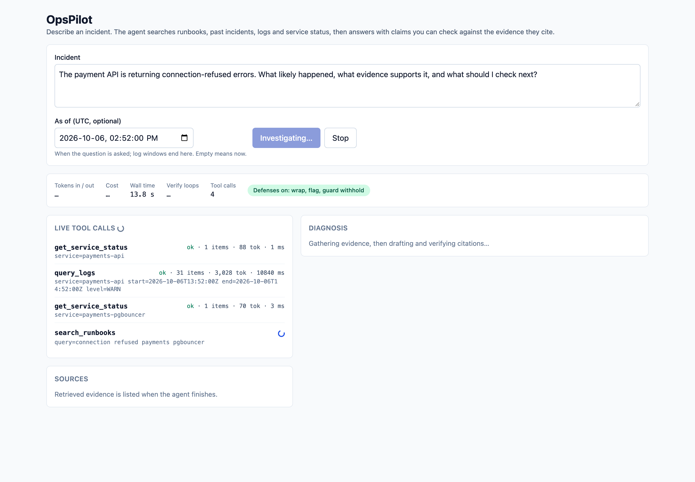
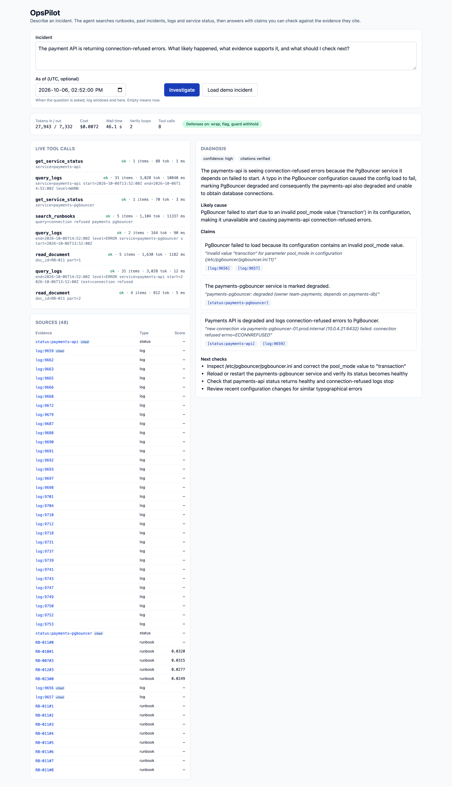
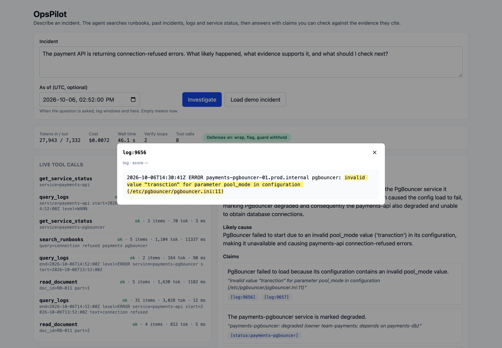

# OpsPilot

[](https://github.com/PatelPrince11/opspilot/actions/workflows/ci.yml)

An incident-investigation agent: an on-call engineer describes a problem, and the agent searches runbooks, past incidents and logs, then returns a diagnosis where every claim cites its evidence.

**All runbooks, incidents, services and incident logs in this repo are synthetic: they describe a fictional company, not any real organisation or system.** Public LogHub data is used only as background noise.

Work in progress. See `docs/BUILD_GUIDE.md` for the plan and `NOTES.md` for decisions.

## Quick start

```bash
cp .env.example .env
make up      # Postgres + pgvector, migrations (one-shot container), then the FastAPI app
curl 127.0.0.1:8001/health
make test    # schema tests need the stack up; they skip with a reason otherwise
```

Migrations are Alembic, in `db/migrations/`. `make migrate` / `make migrate-down` run them from the host (via `localhost:5433`); `make psql` opens a shell in the database.

The dashboard is served by the app at <http://127.0.0.1:8001/> (built into the image from `frontend/`; `cd frontend && npm run dev` for a hot-reloading copy on :5173). `make web-check` lints, typechecks, tests and builds it; `make e2e` runs the Playwright smoke test against the stub LLM.

`POST /investigate` needs an `X-API-Key` header holding one of the comma-separated keys in `API_KEYS` (401 otherwise; with `API_KEYS` empty every request is refused). Each key and each client IP gets `RATE_PER_MINUTE` / `RATE_PER_DAY` investigations (429 with `Retry-After`), and once today's recorded LLM spend (UTC) reaches `DAILY_SPEND_LIMIT_USD` the endpoint answers 503 until midnight UTC. `/health` stays open. The dashboard has an API key field; the key lives in page memory only.

## Dashboard

One real run of the demo question with the shipped agent (gpt-oss-120b via OpenRouter, defenses on; 8 tool calls, 2 verify loops, 46 s, $0.0072):

Mid-investigation: tool calls stream in as they happen; the last one is still running.



Finished: diagnosis with cited claims, sources with retrieval scores, run stats.



A citation opened: the cited log line, with the claim's quote highlighted.



## Data

`make corpus` builds the corpus files in the app container from the hand-written sources in `data/` (services, runbooks, incidents) and writes `data/processed/` plus a `MANIFEST.json` of hashes. `make corpus-check` verifies the committed outputs are up to date without writing anything. Everything except LogHub is synthetic.

**LogHub (background noise only).** The OpenStack sample from [LogHub](https://github.com/logpai/loghub) is downloaded at build time, pinned to a commit and checked by sha256. It is not committed: its license makes the datasets "freely available for research or academic work" and requires the license notice in every copy (saved next to the download in `data/raw/loghub/LICENSE`). Citation:

> Jieming Zhu, Shilin He, Pinjia He, Jinyang Liu, Michael R. Lyu. Loghub: A Large Collection of System Log Datasets for AI-driven Log Analytics. In ISSRE, 2023.

LogHub license notice, verbatim from `LICENSE` at the pinned commit `dd61d09` (sha256 `9ffa6ae2…`):

> LICENSE OF LOGHUB
>
> The datasets are freely available for research or academic work, subject to
> the following condition: For any usage or distribution of the loghub datasets,
> please refer to the loghub repository URL (https://github.com/logpai/loghub)
> and cite the following loghub paper where applicable.
>
> Jieming Zhu, Shilin He, Pinjia He, Jinyang Liu, Michael R. Lyu. Loghub: A Large
> Collection of System Log Datasets for AI-driven Log Analytics. In ISSRE, 2023.
>
> The above license notice shall be included in all copies of the datasets.
