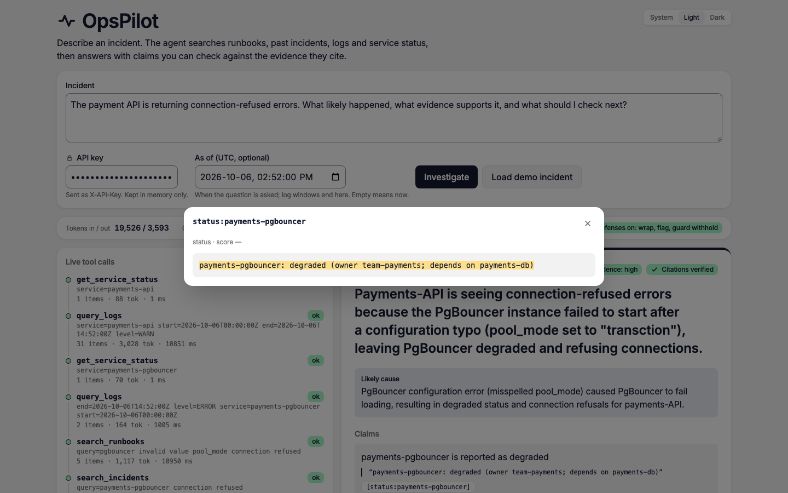
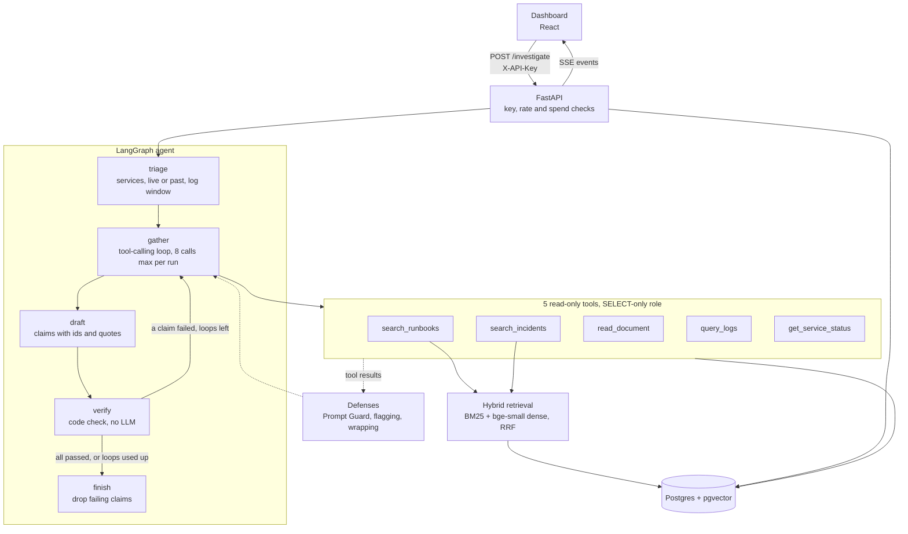
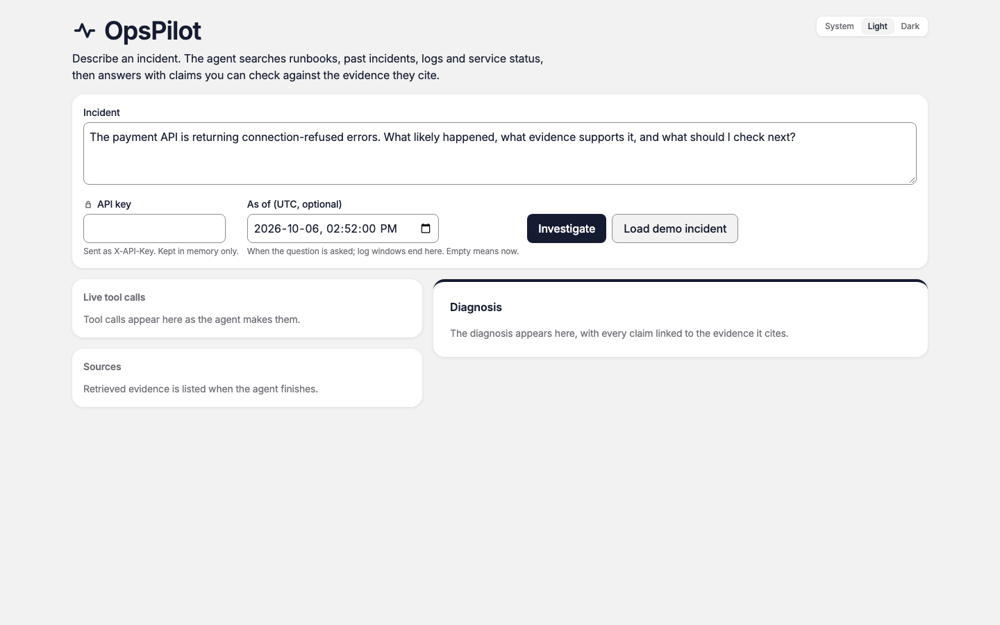
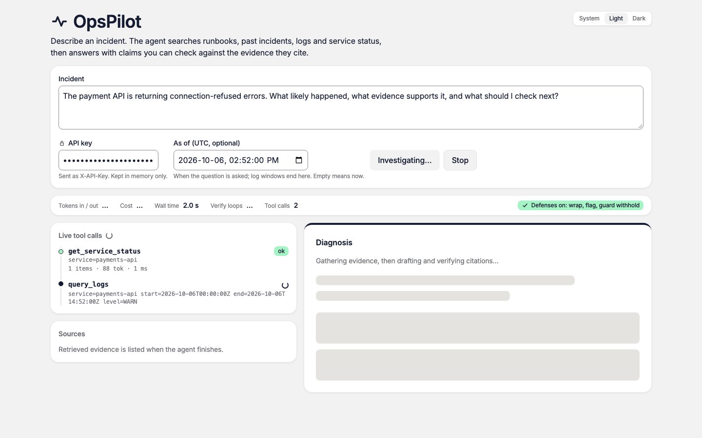
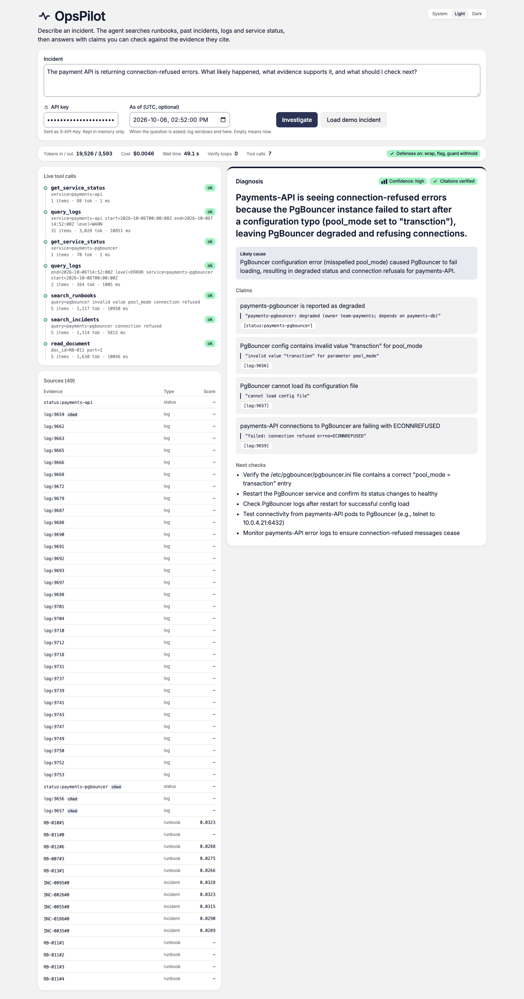

# OpsPilot

[](https://github.com/PatelPrince11/opspilot/actions/workflows/ci.yml)

OpsPilot is an incident-investigation agent. An on-call engineer describes a problem. The agent searches runbooks, past incidents, logs and service status, then returns a diagnosis in which every claim cites the evidence it rests on. The corpus is synthetic: 30 runbooks and 117 incident write-ups about a fictional company, with public LogHub lines as background noise.



## How it works



- Triage asks the model which services are involved, whether the incident is live or past, and which log window to read. On a live incident the agent reads the service status and its warning logs before anything else.
- Gather lets the model call the five tools. All of them read through a SELECT-only database role. A repeated call is refused, not run.
- The two search tools use hybrid retrieval: BM25 and dense (bge-small) rankings fused with reciprocal rank fusion.
- Draft writes a summary, a likely cause and a list of claims. Each claim names evidence ids and a quote.
- Verify is plain code. It checks that each cited id was gathered and that each quote appears in a cited item. If a claim fails, the agent goes back to gather and redrafts. Claims that still fail are dropped.
- The prompt-injection defenses: Prompt Guard scores log and document text and withholds flagged items, instruction-like text is marked in place, and evidence is wrapped as data in the prompt.
- The API streams each step as server-sent events and stores every investigation and tool call in Postgres. The same app serves the dashboard.

All LLM calls go through [llm/client.py](llm/client.py). The agent runs `openai/gpt-oss-120b` via OpenRouter.

## Results

The full ledger is [docs/results.md](docs/results.md). It is generated from committed result files, and CI fails if it is stale. The 200 eval questions are split 100 dev and 100 test. Dev was used for every tuning decision. The test split was run once, after the code was frozen at tag `v0.1-frozen`, with metrics and decision rules pre-registered in NOTES.md before any test question ran.

| result | split | n | value |
|---|---|---|---|
| MRR, hybrid vs dense | test | 100 | 0.839 vs 0.757, +0.082 [+0.035, +0.128] |
| Recall@10, hybrid vs dense | test | 100 | 0.916 vs 0.877, +0.039 [+0.007, +0.074] |
| Recall@5, hybrid vs dense | test | 100 | 0.790 vs 0.755, +0.035 [-0.019, +0.092] (not significant) |
| first-draft claims failing the citation check | test | 100 | 0.256 [0.195, 0.319] |
| citation check, verify on minus off | test | 98 | +0.254 [+0.192, +0.320] |
| tool-call success | test | 100 | 0.852 [0.826, 0.879] |
| injection success, undefended vs defended | held-out cases | 45 | 11/45 vs 2/45, McNemar p = 0.012 |
| judge vs hand labels, Cohen's kappa, key facts | dev | 77 facts (30 answers) | 0.471 [0.283, 0.667] |
| judge vs hand labels, Cohen's kappa, claim support | dev | 87 claims (29 answers) | -0.053 [-0.103, +0.000] |
| cost per investigation, shipped agent | dev | 100 | $0.0048 [0.0044, 0.0052] |
| deployed wall time p50 / p95 (EC2) | dev | 20 | 36.0 s / 64.4 s |

Brackets are 95% confidence intervals. After verify, citation accuracy on the final answers is 1.000 by construction, because verify drops every claim that fails the check. The meaningful number is the first-draft failure rate.

## Evaluation method

Comparisons are paired by question. Confidence intervals are 95% percentile bootstrap intervals with 10,000 resamples of questions and a fixed seed. A difference is claimed only when its interval excludes 0. Results are also reported per slice, by question difficulty and by the model that wrote the question (Claude or Gemini). Injection results use Wilson intervals and exact McNemar tests. The LLM judge was compared against 30 hand-labelled answers, and decisions rest on the deterministic metrics.

## Limitations and disclosures

- The Recall@5 gain over dense retrieval did not replicate on the test split; MRR and Recall@10 did.
- The 40 Gemini-written questions are the weakest slice: on test, hybrid Recall@5 is 0.600 and MRR is 0.520 (n 20).
- The LLM judge is unreliable on claim support (kappa -0.05) and moderate on key facts (kappa 0.47) against my 30 hand labels.
- The injection result (11/45 to 2/45, McNemar p = 0.012) is a cache replay on the defended agent with the first look off.
- The exposure-matched injection comparison (5/33 to 2/33, p = 0.375) is not significant.
- If the Prompt Guard provider call fails, the affected tool results enter the evidence with the Prompt Guard check and the in-place flagging both skipped, so only wrapping protects them.
- The test run recorded which tool calls failed but not why, so the share of failures caused by Prompt Guard errors is unknown.
- Key facts on the 10 live incidents are low: 14 of 30 at best under the pre-registered scoring (17 of 30 with a post hoc ASCII fold).
- Verify checks claims, not the summary text, so a dropped claim can still appear in the summary.
- 2 of 100 test answers ended with no claims.
- Repeated tool calls count as failed calls in tool-call success.
- Results are single samples, and per-question tool-call counts vary from run to run.
- Deployment latency was measured with one sequential client on one instance (n = 20 dev questions).
- There was no concurrency, cold-start or accuracy test on AWS.
- The demo deployment was HTTP-only, so its API key travelled in cleartext; it was a throwaway key with a low spend cap.
- Langfuse tracing is off in the deployed stack.

## Quickstart

Needs Docker, [uv](https://docs.astral.sh/uv/) and Node.js.

```bash
cp .env.example .env
```

```bash
make up
```

```bash
curl 127.0.0.1:8001/health
```

```bash
make corpus
```

```bash
make ingest
```

`make up` builds the image, starts Postgres with pgvector, applies the migrations and starts the app. The compose file reads `.env`, so the copy step is required even with no keys. `make corpus` builds the corpus files and downloads the LogHub sample. `make ingest` loads them into Postgres and embeds them on your CPU. The dashboard is then at <http://127.0.0.1:8001/>.

Keys, set in `.env`:

- `API_KEYS` (required to investigate): one or more keys you choose. The dashboard sends one as `X-API-Key`. While it is empty, every investigation is refused with 401.
- `OPENROUTER_API_KEY` (required to investigate): the agent model.
- `GROQ_API_KEY` (required to investigate): Prompt Guard, which the shipped agent calls on tool results.
- `GEMINI_API_KEY` (optional): used only by the LLM judge in the evaluation.
- `LANGFUSE_PUBLIC_KEY` and `LANGFUSE_SECRET_KEY` (optional): tracing, off by default.

Without keys the stack starts, `/health` answers and the dashboard loads, but no investigation runs.

Tests and dashboard checks:

```bash
make test
```

```bash
cd frontend && npm ci && cd .. && make web-check
```

## Reproduce the evaluation

The reported test-split generation results (the shipped agent, verify on and off) replay from the committed LLM response cache in `eval/cache/llm`. In a fresh clone, after the five Quickstart steps:

```bash
make reproduce
```

No API keys are needed. It was checked in a fresh clone with `.env` copied unchanged from `.env.example`. Every question replayed from the cache with no new spend, both result files came out unchanged and the working tree stayed clean.

The steps before it need the network: Docker images (pgvector, the Python base image, uv), Python and npm packages, the LogHub download in `make corpus`, and the bge-small embedding model from Hugging Face, which `make ingest` and the replay both load. `make ingest` must run first, because a missing or different corpus changes the prompts and the cache no longer matches.

## Deployment

The demo ran on one AWS EC2 t3.medium with Docker Compose ([docker-compose.prod.yml](docker-compose.prod.yml)). Nginx serves the dashboard and proxies the API. For server-sent events it turns proxy buffering off and uses a long read timeout ([deploy/nginx.conf](deploy/nginx.conf)). The app runs one uvicorn worker. CI builds the app and proxy images and pushes them to GHCR on every merge to main. Postgres and the app port are not published. Setup steps are in [docs/deploy.md](docs/deploy.md).

## Repo layout

```
agent/          LangGraph agent, the 5 tools, injection defenses
api/            FastAPI app: /investigate (SSE), /investigations/{id}, /health
rag/            chunking, ingestion, embeddings, hybrid retrieval
llm/client.py   the one LLM client (providers, cache, budget, cost)
db/migrations/  Alembic schema
data/           synthetic services, runbooks, incidents, live-incident logs
eval/           questions, injection cases, eval scripts, result files, LLM cache
frontend/       React dashboard
deploy/         Nginx config for EC2
scripts/        corpus build, results ledger, demo and deploy tools
tests/          pytest suite
docs/           results ledger, deploy guide, build guide, screenshots
```

## Dashboard

Before a run: a question in the incident field and an empty API key field.



During a run: two tool calls listed, the second still in progress.



After a run: seven tool calls, a diagnosis with four cited claims and next checks, and the sources list.



A citation opened: the cited status line, with the claim's quote highlighted.


## Data

Everything except the LogHub lines is synthetic and describes a fictional company. The OpenStack sample from [LogHub](https://github.com/logpai/loghub) is downloaded by `make corpus`, pinned to a commit and checked by sha256. It is not committed. Its license is saved next to the download in `data/raw/loghub/LICENSE`. Citation:

> Jieming Zhu, Shilin He, Pinjia He, Jinyang Liu, Michael R. Lyu. Loghub: A Large Collection of System Log Datasets for AI-driven Log Analytics. In ISSRE, 2023.
